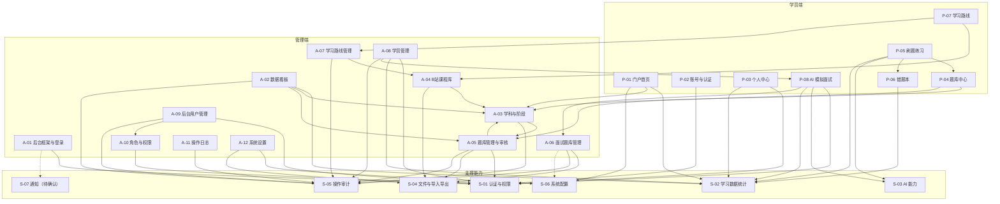

# 云枢智学 · 功能模块梳理

> 文档阶段：第一阶段 · 需求与功能模块梳理  
> 文档状态：待评审  
> 编制日期：2026-11-12  
> 依据材料：`docs/云枢智学-需求文档.md`、`prototype/` 页面原型（学员端 13 页、管理端 12 页）、`prototype/README.md`

## 0. 阅读说明

1. 本文档只做功能与模块层面的梳理，**不涉及技术选型、数据库设计、API 接口设计和代码实现**。
2. 文中标注“待确认”的内容，表示需求文档与页面原型尚未形成明确结论。本文档不做单方面假设，需评审确认后再进入下一阶段。
3. 文中提到的“原型演示数据”仅用于理解页面行为，不作为最终业务规模、统计口径或数据约束。
4. 支撑模块（S-xx）是对需求中已有能力的归并，不代表新增业务功能。

---

## 1. 项目定位与范围

### 1.1 产品定位

云枢智学是 **AI 赋能的智能面试训练平台**。产品围绕“学习内容 → 刷题练习 → 错题复习 → AI 模拟面试 → 能力报告 → 针对性补强”的训练闭环展开。

核心闭环：

```
学科 → 阶段 → 题目 / 课程 / 学习路线
刷题 → 错题 → AI 面试 → 面试报告 → 补强
```

**内容关系（已确认）：**

- 学科与阶段：一对多。
- 学科与课程：**多对多**，同一门课程可关联多个学科。
- 学习路线：**单学科路线**，可引用跨学科补充课程；课程顺序即学习顺序。
- 技术方向：**技术方向即学科**；AI 面试按方向（=学科）组织题目。
- 面试题目：由管理员在后台维护/上传，归属方向 = 学科；**不设独立知识库实体**，来源记录文档名/第 N 题等文本。
- 已学课程：学员在学习路线中**手动勾选课程“已完成”**，勾选记录计入已学课程。

### 1.2 两端的定位

| 端 | 定位 | 部署与账号 |
|---|---|---|
| 学员端（portal） | 面向学员的学习、刷题、面试训练入口 | 独立部署，独立学员账号体系 |
| 管理端（admin） | 面向运营、内容审核、系统管理人员的后台 | 独立部署，独立后台账号体系 |

两端账号体系独立，登录态互不共享；学员端导航中的“管理后台”入口仅在后台账号登录学员端后显示，页脚另保留对所有访客可见的“管理后台”入口。

### 1.3 角色

| 角色 | 所属端 | 权限范围 |
|---|---|---|
| 游客 | 学员端 | 浏览首页、注册、登录、找回密码 |
| 学员 | 学员端 | 刷题练习、错题本、学习路线、AI 模拟面试、个人中心 |
| 超级管理员 | 管理端 | 全部权限，含系统管理 |
| 内容审核 | 管理端 | 查看全部内容并进行题库审核；无新增、编辑、删除、导入导出权限 |
| 运营人员 | 管理端 | 除系统管理外的全部操作；不含题库审核权限 |

### 1.4 本期范围

本期覆盖需求文档第 3、4 章的全部页面与功能：

- **学员端 13 个页面**：首页、登录、注册、找回密码、个人中心、题库中心、刷题练习、错题本、学习路线、AI 面试配置、AI 面试进行、面试报告、面试记录。
- **管理端 12 个页面**：后台登录、数据看板、学科管理、B 站课程库、题库管理、面试题库管理、学习路线管理、学员管理、用户管理、角色管理、操作日志、系统设置。
- **两端独立账号体系与登录态**。
- **AI 能力**：简答批改、AI 模拟面试、单题评分、面试报告生成。
- **安全与频控**：登录失败锁定、验证码获取/校验限制、接口请求频控。

### 1.5 本期明确不开发

以下内容在需求中已明确为占位或不开发：

- 学员端页脚“支持”和“关于”两组外链及对应页面（帮助中心、意见反馈、联系我们、关于我们、用户协议、隐私政策）；这些入口在页脚中作为占位，不开发独立页面。
- 技术选型、数据库设计、API 接口设计、代码实现。

### 1.6 范围待确认

以下内容在需求或原型中只出现入口/名称，但没有完整功能定义，需评审确认是否纳入本期：

- 第三方登录（微信 / QQ / GitHub）。
- 短信验证码的真实发送通道。
- 管理端顶栏通知铃铛及通知中心。
- 面试题库的来源文档名/第 N 题记录规则，以及后续是否扩展 Markdown 之外的文档格式。
- “查看面试回放”的数据范围与保存规则。
- 注册时《用户协议》《隐私政策》的展示页面。

---

## 2. 功能全景

### 2.1 功能结构总览

| 端 | 功能域 | 模块 | 页面 |
|---|---|---|---|
| 学员端 | 门户 | 门户首页 | 首页 |
| 学员端 | 账号 | 账号与认证 | 注册、登录、找回密码 |
| 学员端 | 个人 | 个人中心 | 个人中心 |
| 学员端 | 学习 | 题库中心 | 题库中心 |
| 学员端 | 学习 | 刷题练习 | 刷题练习 |
| 学员端 | 学习 | 错题本 | 错题本 |
| 学员端 | 学习 | 学习路线 | 学习路线 |
| 学员端 | AI 面试 | AI 模拟面试 | 面试配置、面试进行、面试报告、面试记录 |
| 管理端 | 框架 | 后台框架与登录 | 后台登录、公共框架 |
| 管理端 | 概览 | 数据看板 | 数据看板 |
| 管理端 | 内容管理 | 学科与阶段管理、B 站课程库、题库管理与审核、面试题库管理、学习路线管理 | 学科管理、课程库、题库管理、面试题库管理、学习路线 |
| 管理端 | 学员管理 | 学员管理 | 学员管理 |
| 管理端 | 系统管理 | 后台用户管理、角色与权限管理、操作日志、系统设置 | 用户管理、角色管理、操作日志、系统设置 |

### 2.2 学员端功能清单

| 功能域 | 功能点 | 页面 |
|---|---|---|
| 门户首页 | Hero 首屏、平台数据、快速开始、核心功能、学习统计、近 7 天练习、热门阶段、AI 面试介绍、页脚、新手引导 | `portal/index.html` |
| 账号与认证 | 账号密码登录、手机验证码登录、注册、找回密码、第三方登录入口、记住我、安全频控提示 | `portal/login.html`、`register.html`、`forgot-password.html` |
| 个人中心 | 用户卡片、基本信息编辑、头像上传、学习数据 | `portal/profile.html` |
| 题库中心 | 学科 → 阶段 → 题目三级浏览、题型/难度筛选、关键词搜索、题目详情入口、空态 | `portal/questions.html` |
| 刷题练习 | 顺序/随机模式、答题卡、计时、判分、简答 AI 批改、解析、快捷键、会话恢复、结束练习 | `portal/practice.html` |
| 错题本 | 统计卡、高频错题 Top3、筛选排序、错题浏览、重做、纠正进度、标记掌握、移除、批量操作 | `portal/wrong-book.html` |
| 学习路线 | 学科选择、路线头部、有序课程列表、B 站跳转、课程完成勾选、空态 | `portal/routes.html` |
| AI 模拟面试 | 面试配置、配额、面试对话、语音输入/播报、评分、报告、面试记录、回放 | `portal/ai-config.html`、`ai-interview.html`、`interview-report.html`、`interview-history.html` |

### 2.3 管理端功能清单

| 功能域 | 功能点 | 页面 |
|---|---|---|
| 后台框架与登录 | 管理员登录、登录守卫、菜单、顶栏、通知入口、退出登录、返回前台 | `admin/login.html`、后台公共框架 |
| 数据看板 | 统计卡片、快捷操作、用户增长趋势、题目学科分布、最近活动 | `admin/index.html` |
| 学科与阶段管理 | 学科 CRUD/排序/启禁用、阶段 CRUD/排序/启禁用、统计与删除提示 | `admin/subjects.html` |
| B 站课程库 | 课程 CRUD、筛选搜索、批量文本导入、多学科关联（含其他学科）、来源 | `admin/courses.html` |
| 题库管理与审核 | 题目 CRUD、状态机、审核、批量上架/下架/删除、Excel 导入导出、题目详情与答题统计 | `admin/questions.html` |
| 面试题库管理 | 按方向（=学科）的面试题总览、来源展示、筛选、手工录入、Markdown 导入、主题/难度维护 | `admin/question-bank.html` |
| 学习路线管理 | 路线 CRUD、状态、课程关联与排序、从课程库添加、学员视角预览 | `admin/routes.html` |
| 学员管理 | 学员列表、搜索筛选、详情（含已学课程）、启用/禁用、删除、批量操作 | `admin/students.html` |
| 后台用户管理 | 后台账号 CRUD、角色分配、重置密码、启用/禁用、批量操作、用户详情 | `admin/users.html` |
| 角色与权限管理 | 角色 CRUD、9 组权限树勾选、全量覆盖、预置角色 | `admin/roles.html` |
| 操作日志 | 全部写操作与登录/登出日志查询、详情、导出 CSV、清空、分页 | `admin/logs.html` |
| 系统设置 | 平台名称、平台描述、Logo、默认头像、重置与保存 | `admin/settings.html` |

---

## 3. 功能模块划分

### 3.1 划分原则

1. **按业务能力和使用端划分**：学员端模块面向学习与训练，管理端模块面向内容生产与运营治理。
2. **页面模块与支撑能力分离**：页面模块承担用户可见流程；支撑模块（S-xx）承担被多个页面复用的认证、统计、AI、文件、审计、配置、通知能力。
3. **单一职责**：每个模块有明确的目标、输入、输出和“不负责”的边界，避免跨模块直接修改数据。
4. **不新增需求外功能**：模块清单只覆盖需求文档与原型中已有的功能；缺口与歧义统一进入“待确认问题”。
5. **内容生产与消费分离**：管理端生产内容，学员端只消费已发布内容；内容状态决定学员端可见性。

### 3.2 模块总览

| 编号 | 模块 | 所属端 | 核心职责 | 主要页面 | 不负责 |
|---|---|---|---|---|---|
| P-01 | 门户首页 | 学员端 | 平台入口聚合、学习概览、内容推荐、新手引导 | 首页 | 不承载练习/面试业务逻辑 |
| P-02 | 账号与认证 | 学员端 | 注册、登录、找回密码、登录态、协议与频控提示 | 登录、注册、找回密码 | 不负责个人资料编辑、后台登录 |
| P-03 | 个人中心 | 学员端 | 个人资料、头像、学习数据概览 | 个人中心 | 不负责密码/手机号变更 |
| P-04 | 题库中心 | 学员端 | 学科 → 阶段 → 题目浏览、筛选、搜索、练习入口 | 题库中心 | 不负责判分、题目维护 |
| P-05 | 刷题练习 | 学员端 | 练习会话、判分、AI 批改、解析、进度恢复 | 刷题练习 | 不负责错题规则、题库维护 |
| P-06 | 错题本 | 学员端 | 错题沉淀、复习、掌握、批量操作 | 错题本 | 不负责练习判分 |
| P-07 | 学习路线 | 学员端 | 按学科展示单学科路线、有序课程与完成勾选 | 学习路线 | 不负责路线/课程维护 |
| P-08 | AI 模拟面试 | 学员端 | 面试配置、从面试题库取题、进行、评分、报告、记录、回放 | AI 配置、面试、报告、记录 | 不负责面试题库维护、AI 能力实现 |
| A-01 | 后台框架与登录 | 管理端 | 登录、菜单、顶栏、登录守卫、通知占位 | 后台登录、公共框架 | 不负责用户/角色维护 |
| A-02 | 数据看板 | 管理端 | 运营概览、趋势、分布、最近活动 | 数据看板 | 不负责原始数据生产 |
| A-03 | 学科与阶段管理 | 管理端 | 学科/阶段 CRUD、排序、启禁用 | 学科管理 | 不负责题目、课程、路线内容 |
| A-04 | B 站课程库 | 管理端 | 课程 CRUD、学科多选关联、筛选、批量导入 | 课程库 | 不负责路线编排 |
| A-05 | 题库管理与审核 | 管理端 | 题目 CRUD、审核状态机、批量、导入导出 | 题库管理 | 不负责学员判分、面试题库 |
| A-06 | 面试题库管理 | 管理端 | 方向=学科的面试题总览、来源、主题/难度、录入/上传；无独立知识库实体 | 面试题库管理 | 不维护独立知识库实体 |
| A-07 | 学习路线管理 | 管理端 | 路线 CRUD、课程关联/排序、预览 | 学习路线 | 不负责课程库维护 |
| A-08 | 学员管理 | 管理端 | 学员列表、详情（含已学课程）、启禁用、批量 | 学员管理 | 不负责学员注册与资料编辑 |
| A-09 | 后台用户管理 | 管理端 | 后台账号 CRUD、重置密码、启禁用 | 用户管理 | 不负责角色权限定义 |
| A-10 | 角色与权限管理 | 管理端 | 角色 CRUD、9 组权限树、全量覆盖 | 角色管理 | 不负责用户分配、实际鉴权 |
| A-11 | 操作日志 | 管理端 | 日志查询、详情、导出、清空 | 操作日志 | 不负责日志产生 |
| A-12 | 系统设置 | 管理端 | 平台品牌信息、Logo、默认头像 | 系统设置 | 不负责业务参数配置（阈值固定常量） |
| S-01 | 认证与权限 | 支撑 | 账号、凭证、登录态、RBAC、频控 | 无独立页面 | 不负责资料编辑、后台用户管理 |
| S-02 | 学习数据统计 | 支撑 | 学习/练习/错题/面试/已学课程统计聚合 | 无独立页面 | 不负责业务规则、原始数据维护 |
| S-03 | AI 能力 | 支撑 | 简答批改、面试出题/评分、报告生成 | 无独立页面 | 不负责题库、会话 UI |
| S-04 | 文件与导入导出 | 支撑 | 头像/Logo/默认头像、Excel/Markdown 导入导出 | 无独立页面 | 不负责业务字段校验 |
| S-05 | 操作审计 | 支撑 | 记录全部管理端写操作、登录/登出与导出 | 无独立页面 | 不负责日志查询 UI |
| S-06 | 系统配置 | 支撑 | 品牌与业务参数读取 | 无独立页面 | 不负责配置页面 |
| S-07 | 通知 | 支撑（待确认） | 通知生成、已读、展示 | 顶栏通知 | 是否本期开发待确认 |

### 3.3 学员端模块职责

#### P-01 门户首页

| 项 | 内容 |
|---|---|
| 模块目标 | 让游客/学员快速理解平台价值，并进入题库、练习、路线、AI 面试等核心路径。 |
| 核心职责 | Hero 首屏与平台数据；快速开始 4 张卡；核心功能 4 张卡；学习统计；近 7 天练习柱状图；热门阶段；AI 面试介绍；页脚；新手引导；导航登录态。 |
| 主要输入 | 学科/阶段内容（A-03）、学习统计（S-02）、平台品牌（S-06）、登录态（S-01）。 |
| 主要输出 | 页面跳转、新手引导完成标记。 |
| 不负责 | 不产生练习/面试数据；不维护内容；不定义统计口径。 |
| 待确认 | 平台数据与“好评率”的来源；“热门阶段”排序规则；新手引导选择的技术方向是否落库。 |

#### P-02 账号与认证

| 项 | 内容 |
|---|---|
| 模块目标 | 完成学员账号的注册、登录、找回密码与登录态维护。 |
| 核心职责 | 账号密码登录；手机验证码登录；注册（手机号、验证码、密码、确认密码、协议勾选）；找回密码三步流程；记住我；第三方登录入口；登录失败锁定与频控提示；未登录跳转。 |
| 主要输入 | 手机号、验证码、密码、登录态。 |
| 主要输出 | 学员登录态、注册结果、重置密码结果。 |
| 不负责 | 个人资料编辑（P-03）；后台登录（A-01）；角色权限（S-01/A-10）。 |
| 待确认 | 第三方登录是否本期实现；短信通道；邮箱登录规则；协议页面；记住我时长。 |

#### P-03 个人中心

| 项 | 内容 |
|---|---|
| 模块目标 | 让学员管理个人资料并查看学习数据。 |
| 核心职责 | 用户卡片（头像、昵称、角色标签、做题数/面试数/错题数）；基本信息（头像上传、用户名、手机号只读脱敏、邮箱、性别）；学习数据（已完成题目、正确率、AI 面试次数）。 |
| 主要输入 | 学员资料（S-01）、学习统计（S-02）、错题/面试数据（P-06/P-08）。 |
| 主要输出 | 更新后的个人资料。 |
| 不负责 | 不修改手机号、密码；不定义统计口径。 |
| 待确认 | 个人中心缺少“技术方向”字段；头像大小上限；统计口径。 |

#### P-04 题库中心

| 项 | 内容 |
|---|---|
| 模块目标 | 提供学科 → 阶段 → 题目的内容发现与练习入口。 |
| 核心职责 | 左侧学科栏；阶段列表视图；题目列表视图；题型/难度筛选；关键词搜索；题目卡（题型、难度、阶段、N 人做过、正确率、标签）；查看解析/开始练习；空态。 |
| 主要输入 | 已上架学科、阶段、题目（A-03/A-05）。 |
| 主要输出 | 进入练习会话（P-05）。 |
| 不负责 | 不判分；不维护题目；不处理审核状态。 |
| 待确认 | 搜索字段范围；“N 人做过/正确率”的统计口径；禁用阶段是否对学员可见。 |

#### P-05 刷题练习

| 项 | 内容 |
|---|---|
| 模块目标 | 完成一次练习，产生判分、错题与学习统计数据。 |
| 核心职责 | 练习模式选择（顺序/随机/取消）；答题视图（返回题库、标题、进度、计时、答题卡、结束练习）；单选/多选/判断/简答渲染；选择题判分；简答 AI 批改（0-10 分，≥6 分通过）；解析展示；上一题/下一题/完成；快捷键；练习进度本地持久化与恢复；结束练习校验。 |
| 主要输入 | 题目（A-05）、练习模式、学员答案。 |
| 主要输出 | 判分结果、AI 批改结果、错题记录（P-06）、学习统计（S-02）。 |
| 不负责 | 不定义错题掌握规则；不维护题库。 |
| 待确认 | 多选提交时机；随机练习范围；AI 批改失败/超时处理；结束练习时多题未作答简答的跳转规则；会话本地还是服务端保存。 |

#### P-06 错题本

| 项 | 内容 |
|---|---|
| 模块目标 | 沉淀练习中的错题，并通过重做与纠正进度帮助学员掌握。 |
| 核心职责 | 统计卡（错题总数/待复习/已掌握/掌握率）；高频错题 Top3；状态/分类/时间筛选与排序；错题卡（错误次数徽章、纠正进度、题干、分类、最近答错日期、你的答案、正确答案）；重新做题；标记已掌握；移除错题；批量标记/移除；重做模式；空态。 |
| 主要输入 | 练习判分结果（P-05）、题目内容（A-05）。 |
| 主要输出 | 错题状态（待复习/已掌握）、纠正进度、错题统计。 |
| 不负责 | 不判分；不维护题目。 |
| 待确认 | 答错是否重置纠正次数；移除后再次答错是否重新进入；标记已掌握后再次答错是否恢复待复习；答对是否减少错误次数。 |

#### P-07 学习路线

| 项 | 内容 |
|---|---|
| 模块目标 | 按学科提供有序的 B 站课程学习路径。 |
| 核心职责 | 8 个学科卡片单选；路线头部（路线名、适合人群、描述、课程数、总时长、按顺序学习）；有序课程列表（序号、封面、标题、BV 号、时长、播放量、去 B 站学习、完成勾选）；空态。 |
| 主要输入 | 启用中的单学科学习路线与课程（A-04/A-07）。 |
| 主要输出 | 跳转 B 站视频页；课程完成勾选记录（计入已学课程）。 |
| 不负责 | 不维护路线/课程；不自动记录视频观看时长/进度（仅手动勾选）。 |
| 待确认 | 同一学科多路线时的展示规则；禁用路线是否可见；非 B 站课程的按钮文案/链接；播放量来源；勾选完成是否可撤销、重复勾选如何处理。 |

#### P-08 AI 模拟面试

| 项 | 内容 |
|---|---|
| 模块目标 | 模拟真实面试节奏，给出单题评分与综合能力报告。 |
| 核心职责 | 面试配置（技术方向=学科、难度、题数、固定 5 分钟超时、每日配额）；面试进行（AI 提问、文本/语音作答、分析/评分中提示、下一题、结束面试、进度面板、侧边栏、网络状态、语音播报、会话恢复）；面试报告（综合评分、回答准确度、时长、题数、同方向趋势、6 维度、优缺点、改进建议、能力提升建议、历史记录、再来一次、回放）；面试记录（统计卡、列表、分页）。 |
| 主要输入 | 面试配置、A-06 面试题库（按方向=学科、难度取题）、学员回答、历史面试记录。 |
| 主要输出 | 面试会话、单题评分、面试报告、面试记录。 |
| 不负责 | 不维护面试题库（A-06）；不实现 AI 能力（S-03）；不定义配额后台配置。 |
| 待确认 | 题目数量不足时的处理；配额消耗与“再来一次”规则；超时行为；6 维度名称与评分换算；回答准确度口径；回放数据范围；AI 失败降级；语音是否需要服务端能力。 |

### 3.4 管理端模块职责

#### A-01 后台框架与登录

| 项 | 内容 |
|---|---|
| 模块目标 | 提供管理端统一登录、导航框架与访问守卫。 |
| 核心职责 | 管理员账号/密码登录；记住登录状态；忘记密码提示联系超级管理员；登录守卫；左侧 4 组 11 项菜单；顶栏（折叠、页面标题、通知铃铛、管理员下拉）；退出二次确认；返回学员前台；按权限控制菜单/按钮可见性。 |
| 主要输入 | 后台账号凭证（S-01）、角色权限（A-10）、平台品牌（S-06）。 |
| 主要输出 | 管理端登录态、页面导航。 |
| 不负责 | 不维护后台用户/角色；不定义通知规则。 |
| 待确认 | 通知铃铛是否本期开发；9 组权限点清单（后续细化）；记住登录时长。 |

#### A-02 数据看板

| 项 | 内容 |
|---|---|
| 模块目标 | 为运营/管理员提供平台运营概览与快捷入口。 |
| 核心职责 | 统计卡片（学科数量、题目数量、注册用户、AI 面试次数及趋势文案）；快捷操作（管理学习路线、创建新路线、B 站课程库）；用户增长趋势折线图（7/30/90 天）；题目学科分布图；最近活动表格；跳转操作日志。 |
| 主要输入 | 内容统计（A-03/A-05）、学习/面试统计（S-02）、操作日志（S-05）。 |
| 主要输出 | 看板展示与快捷跳转。 |
| 不负责 | 不生产原始数据；不维护日志。 |
| 待确认 | 趋势文案口径；最近活动是否等同操作日志；统计时间范围。 |

#### A-03 学科与阶段管理

| 项 | 内容 |
|---|---|
| 模块目标 | 维护内容体系的一级学科与二级阶段。 |
| 核心职责 | 统计卡（总学科数、有阶段的学科、阶段总数、题目总数）；学科卡片（图标、名称、排序、描述、课程数/路线数/题目数、阶段列表）；学科新增/编辑/删除/上移/下移；阶段新增/编辑/删除/上移/下移/启用/禁用；学科表单（名称、图标 Emoji、描述、排序号、主题颜色）；阶段表单（图标、名称、排序号）；删除影响提示。 |
| 主要输入 | 学科/阶段数据、关联题目/课程/路线数量。 |
| 主要输出 | 学科与阶段内容。 |
| 不负责 | 不维护题目、课程、路线内容。 |
| 待确认 | 删除学科对题目/课程关联/路线/面试题目/历史面试记录的影响；阶段启禁用对学员端的影响；新增学科是否自动出现在 AI 面试方向列表。 |

#### A-04 B 站课程库

| 项 | 内容 |
|---|---|
| 模块目标 | 维护可被学习路线引用的课程库。 |
| 核心职责 | 统计卡（课程总数、总时长、关联学科数）；按标题/学科/来源筛选；新增课程；批量导入；课程表格（序号、封面、名称、时长、关联学科、来源、操作）；编辑/删除；课程表单（名称、封面 URL、时长、关联学科（可多选，含“其他学科”兜底）、来源、课程链接、BV 号提取）；批量导入文本解析、预览、确认；空态。 |
| 主要输入 | 课程数据、学科列表。 |
| 主要输出 | 课程库内容。 |
| 不负责 | 不编排学习路线；不抓取 B 站数据。 |
| 已确认规则 | 学科与课程为多对多关系；同一门课程可关联多个学科；按学科筛选时返回所有关联该学科的课程。 |
| 待确认 | 播放量来源；封面是否支持上传；课程链接失效检测；“其他学科”兜底项与多选学科的组合规则；课程关联多个学科时课程库/路线的展示与分组。 |

#### A-05 题库管理与审核

| 项 | 内容 |
|---|---|
| 模块目标 | 维护题库内容，并通过审核状态机控制学员端可见性。 |
| 核心职责 | 统计卡（题目总数、已上架、待审核、各题型数量）；关键词/阶段/类型/难度/状态筛选；Excel 导入、Excel 导出、新增题目；批量上架/下架/删除；题目表格；行操作（通过/不通过/编辑/删除/上架/下架/重新提交）；题目详情；题目表单（题干、阶段、类型、难度、标签、选项管理、正确答案、解析、状态只读）；Excel 导入（.xlsx/.xls，单次最多 500 道，模板下载、拖拽上传、解析预览）；空态。 |
| 主要输入 | 题目数据、学科/阶段（A-03）、操作人权限（S-01）。 |
| 主要输出 | 题库内容、审核状态、导入导出结果。 |
| 不负责 | 不负责学员判分；不维护面试题库。 |
| 待确认 | “草稿”状态的创建入口；批量上架是否绕过审核；编辑已上架题目是否改变状态；导出范围；软删除对历史数据的影响；运营/审核权限冲突。 |

**题目状态机（需求已明确）：**

```
新增 → 待审核
待审核 → 审核通过 → 已上架
待审核 → 审核不通过 → 已驳回 → 重新提交 → 待审核
已上架 → 下架 → 已下架 → 重新上架 → 待审核
```

#### A-06 面试题库管理

| 项 | 内容 |
|---|---|
| 模块目标 | 按方向（=学科）维护面试题的主题与难度，为面试内容提供可检索的题目池。 |
| 核心职责 | 题干搜索；方向（=学科）/主题/难度筛选；“只看未分类”与主题下拉互斥；手动导入；录入题目；表格（题目、来源、方向、难度、主题、操作）；来源三类（文档解析、手工录入、手动导入 Markdown），记录文档名/第 N 题等文本；详情；编辑主题/难度；逻辑删除；分页（10/20/50）；Markdown 导入（按 `#`~`###` 切题、解析预览、统一方向/主题/难度/标签、单次最多 500 道）；空态。 |
| 主要输入 | 面试题数据、方向/学科列表、主题词表、Markdown 文件。 |
| 主要输出 | 面试题方向/主题/难度维护结果、导入结果。 |
| 不负责 | 不维护独立知识库实体（已确认无知识库实体）；不定义主题词表（待确认）；不实现 AI 面试出题逻辑（由 S-03 执行）。 |
| 已确认规则 | 面试题目归属方向 = 学科；无独立知识库实体；面试题目由管理员在后台维护/上传；A-06 是 AI 面试的题源，P-08 按方向（=学科）与难度取题。 |
| 待确认 | 来源文档名/第 N 题的记录规则；主题词表配置；权限点“上传/检索测试”的具体功能；方向（=学科）在录入/导入后是否允许修改；后续是否扩展 Markdown 之外的文档格式。 |

#### A-07 学习路线管理

| 项 | 内容 |
|---|---|
| 模块目标 | 维护学科学习路线及其有序课程。 |
| 核心职责 | 路线卡片列表（名称、状态、学科、适合学历、课程数、总时长、描述、前 4 门课程预览、状态切换）；新建/编辑（基本信息：名称、关联学科、状态、图标、适合学历、描述；路线课程：按路线学科筛选/勾选课程（课程可关联多个学科）、↑↓ 排序、移除）；路线详情（课程表格、排序、移除、从课程库添加、学员视角预览）；空态。 |
| 主要输入 | 课程库（A-04）、路线数据、学科列表。 |
| 主要输出 | 学习路线与课程顺序。 |
| 不负责 | 不维护课程库。 |
| 已确认规则 | 学习路线归属单学科；课程选择器保留“其他学科课程（跨学科补充）”分组。 |
| 待确认 | 每个学科的路线数量限制；禁用路线是否对学员隐藏；路线排序规则。 |

#### A-08 学员管理

| 项 | 内容 |
|---|---|
| 模块目标 | 管理前台注册学员，查看学习与面试情况。 |
| 核心职责 | 昵称/手机号搜索；状态筛选；批量启用/禁用/删除；学员表格（学员、手机号、注册时间、学习天数、刷题·面试、状态、操作）；行操作（查看详情、禁用/启用、删除）；学员详情（资料、学习统计、已学课程、面试次数）；空态。 |
| 主要输入 | 学员账号（S-01）、学习统计（S-02）、面试记录（P-08）。 |
| 主要输出 | 学员状态变更。 |
| 不负责 | 不新增/编辑学员；不定义学习统计口径。 |
| 已确认规则 | “已学课程”=学员在学习路线中手动勾选“已完成”的课程。 |
| 待确认 | 禁用/删除对登录态、历史数据的影响；学习天数/正确率口径；已学课程勾选的撤销/重复处理；删除是否可恢复。 |

#### A-09 后台用户管理

| 项 | 内容 |
|---|---|
| 模块目标 | 管理后台内部账号。 |
| 核心职责 | 用户名/手机号搜索；角色/状态筛选；批量启用/禁用/删除；用户表格（用户、手机号、角色、状态、最后登录、操作）；行操作（编辑、禁用/启用、重置密码、删除）；新增用户（用户名、手机号、邮箱、角色、密码、状态）；编辑用户（可选新密码、角色下拉不含超级管理员、编辑内置超级管理员时角色只读）；用户详情（资料、最近操作）；空态。 |
| 主要输入 | 后台账号数据、角色列表（A-10）。 |
| 主要输出 | 后台账号维护结果。 |
| 不负责 | 不定义角色权限；不执行登录鉴权（S-01）。 |
| 待确认 | 重置密码默认值；超级管理员唯一性；删除用户与日志/操作记录的关联；批量删除保护。 |

#### A-10 角色与权限管理

| 项 | 内容 |
|---|---|
| 模块目标 | 定义后台角色及其权限点。 |
| 核心职责 | 角色卡片（名称、编码、用户数、描述、权限标签）；新增角色；编辑权限（权限树勾选、全量覆盖）；删除角色（有用户时禁用并提示）；新增角色表单（名称、编码唯一、描述）；预置角色（超级管理员、内容审核、运营人员）；权限树 9 组（题库管理、面试题库管理、用户管理、学习路线、学员管理、系统管理、学科管理、B站课程库、数据看板）。 |
| 主要输入 | 权限点定义、角色数据、用户数。 |
| 主要输出 | 角色与权限配置。 |
| 不负责 | 不分配用户（A-09）；不执行实际鉴权（S-01）。 |
| 待确认 | 预置角色可否编辑/删除；自定义角色权限范围；9 组各组权限点清单（后续设计细化）；内容审核/运营人员的权限映射。 |

**权限树（已确认扩为 9 组；前 6 组权限点来自需求，后 3 组权限点待细化）：**

| 分组 | 权限点 |
|---|---|
| 题库管理 | 查看、新增、编辑、删除、导入、导出、审核 |
| 面试题库管理 | 查看、上传、编辑、删除、检索测试 |
| 用户管理 | 查看、新增、编辑、禁用 |
| 学习路线 | 查看、新增、编辑、删除 |
| 学员管理 | 查看、编辑、删除 |
| 系统管理 | 日志查看、系统设置 |
| 学科管理 | 查看、新增、编辑、删除（待细化） |
| B站课程库 | 查看、新增、编辑、删除、导入（待细化） |
| 数据看板 | 查看（待细化） |

#### A-11 操作日志

| 项 | 内容 |
|---|---|
| 模块目标 | 提供后台关键操作的查询、导出与清空能力。 |
| 核心职责 | 关键词/操作类型/日期范围筛选；导出 CSV；清空日志（二次确认）；日志表格（用户、操作、目标、IP 地址、时间）；日志详情（用户、类型、对象、IP、时间、日志 ID）；分页；空态。 |
| 主要输入 | 操作审计记录（S-05）。 |
| 主要输出 | 日志查询结果、CSV 文件。 |
| 不负责 | 不定义日志产生规则；不负责业务操作本身。 |
| 待确认 | 必须记录的操作清单；日志保留期限；清空范围；导出范围；日志不可篡改要求。 |

#### A-12 系统设置

| 项 | 内容 |
|---|---|
| 模块目标 | 配置平台品牌信息与展示内容。 |
| 核心职责 | 基本信息设置（平台名称必填、平台描述、Logo 上传、默认头像上传）；重置为默认值；保存校验；品牌信息在学员端/管理端的展示同步。 |
| 主要输入 | 平台配置（S-06）、上传文件（S-04）。 |
| 主要输出 | 平台品牌配置。 |
| 不负责 | 不负责业务参数配置（待确认）。 |
| 待确认 | 主题词表、默认密码、面试配额、登录锁定阈值等是否纳入系统设置；图片格式/大小限制。 |

### 3.5 支撑模块职责

#### S-01 认证与权限

| 项 | 内容 |
|---|---|
| 核心职责 | 学员账号注册/登录/找回密码/状态校验；后台账号登录；登录态维护；密码与验证码校验；登录失败锁定；接口频控；RBAC 角色权限模型与鉴权；学员端与后台端账号体系隔离。 |
| 服务对象 | P-02、P-03、P-08、A-01、A-05、A-08、A-09、A-10。 |
| 不负责 | 个人资料编辑 UI（P-03）；后台用户管理 UI（A-09）；角色权限配置 UI（A-10）。 |
| 待确认 | 登录态时长；多端登录；第三方登录；短信通道；同一手机号能否同时注册学员与后台账号。 |

#### S-02 学习数据统计

| 项 | 内容 |
|---|---|
| 核心职责 | 聚合练习/正确率/连续学习天数/近 7 天练习/错题/面试/学习天数/已学课程等数据；为首页、个人中心、数据看板、学员详情提供只读统计。 |
| 服务对象 | P-01、P-03、P-05、P-06、P-08、A-02、A-08。 |
| 不负责 | 不定义业务规则（以各业务模块为准）；不修改原始业务数据。 |
| 待确认 | 所有统计口径；已学课程的数据来源；平台营销数据是否纳入统计。 |

#### S-03 AI 能力

| 项 | 内容 |
|---|---|
| 核心职责 | 简答题 AI 批改；AI 面试提问/下一题控制；单题评分；面试报告生成（总分、准确度、维度、优缺点、建议）；输出结构校验与失败降级。 |
| 服务对象 | P-05、P-08；题目由 P-08 从 A-06 获取，S-03 只负责评分/报告，不负责题库。 |
| 不负责 | 不管理题库；不承载面试会话 UI；不定义配额。 |
| 待确认 | 评分标准；6 个能力维度；失败降级；内容安全；调用成本/配额。 |

#### S-04 文件与导入导出

| 项 | 内容 |
|---|---|
| 核心职责 | 头像、Logo、默认头像的格式与大小校验；Excel 题库导入/导出；Markdown 面试题导入；CSV 日志导出；导入解析预览与结果反馈。 |
| 服务对象 | P-03、A-04、A-05、A-06、A-11、A-12。 |
| 不负责 | 不定义业务字段校验规则（由业务模块负责）。 |
| 待确认 | 文件存储方式（后续设计）；文件大小/格式；导入失败回滚；导出范围。 |

#### S-05 操作审计

| 项 | 内容 |
|---|---|
| 核心职责 | 记录全部管理端写操作、登录/登出与数据导出的操作人、操作类型、操作对象、时间、IP、详情；为 A-11 和数据看板“最近活动”提供数据。 |
| 服务对象 | A-02、A-03、A-04、A-05、A-06、A-07、A-08、A-09、A-10、A-11、A-12。 |
| 不负责 | 不负责日志查询 UI；不定义业务操作。 |
| 待确认 | 必须记录的操作清单；保留期限；敏感信息脱敏。 |

#### S-06 系统配置

| 项 | 内容 |
|---|---|
| 核心职责 | 平台品牌信息读取（平台名称、描述、Logo、默认头像）；业务参数读取（待确认范围）。 |
| 服务对象 | P-01、A-01、A-12，以及可能引用配置的 A-06/P-08。 |
| 不负责 | 不负责配置页面（A-12）。 |
| 待确认 | 主题词表、默认密码、面试每日配额、登录锁定阈值等是否纳入配置。 |

#### S-07 通知（待确认）

| 项 | 内容 |
|---|---|
| 核心职责 | 若纳入本期：通知生成、未读角标、通知列表、已读状态。 |
| 服务对象 | A-01 顶栏。 |
| 不负责 | 待确认。 |
| 待确认 | 是否本期开发；通知类型（待审核、新学员、课程链接失效等）；触发规则；已读状态；权限。 |

---

## 4. 模块关系

### 4.1 模块关系总图



> 说明：实线表示已确认的依赖；虚线表示尚未确认的依赖（S-06 与 A-06、S-07 与 A-01）。

### 4.2 主要依赖关系

| 消费方 | 依赖方 | 关系说明 |
|---|---|---|
| P-02 账号与认证 | S-01 认证与权限 | 注册、登录、找回密码、登录态、频控 |
| P-03 个人中心 | S-01、S-02、P-06、P-08 | 资料、学习统计、错题数、面试数 |
| P-01 门户首页 | S-02、A-03、S-06 | 学习统计、热门阶段、平台品牌 |
| P-04 题库中心 | A-03、A-05 | 学科/阶段、已上架题目 |
| P-05 刷题练习 | P-04、P-06、S-02、S-03 | 题目、错题写入、统计、简答批改 |
| P-06 错题本 | P-05、S-02 | 错题来源、错题统计 |
| P-07 学习路线 | A-04、A-07 | 课程库、启用路线 |
| P-08 AI 模拟面试 | S-01、S-02、S-03、A-06 | 配额/登录态、统计、AI 评分/报告、按方向（=学科）/难度取题 |
| A-01 后台框架 | S-01、S-07（待确认） | 后台登录、登录态、通知 |
| A-02 数据看板 | S-02、A-03、A-05、S-05 | 统计、内容数量、最近活动 |
| A-03 学科与阶段 | A-05、S-05 | 题目数量、操作日志 |
| A-04 课程库 | A-03、S-04、S-05 | 多学科关联、导入、日志 |
| A-05 题库管理与审核 | A-03、S-01、S-02、S-04、S-05 | 阶段、权限、答题统计、导入导出、日志 |
| A-06 面试题库管理 | S-04、S-05、S-06（待确认） | Markdown 导入、日志、主题词表 |
| A-07 学习路线管理 | A-04、S-05 | 课程库、日志 |
| A-08 学员管理 | S-01、S-02、P-08、S-05 | 学员账号、学习统计、面试记录、日志 |
| A-09 后台用户管理 | S-01、A-10、S-05 | 账号、角色、日志 |
| A-10 角色与权限 | S-01、A-09 | 权限模型、用户数 |
| A-11 操作日志 | S-05 | 日志数据 |
| A-12 系统设置 | S-06、S-04 | 配置、图片上传 |

### 4.3 内容生产与消费关系

1. **内容生产链**：A-03 学科/阶段 → A-05 题库 → P-04 题库中心 → P-05 刷题练习。
2. **课程与路线链**：A-04 课程库 → A-07 学习路线 → P-07 学习路线。
3. **面试内容链**：A-06 面试题库（管理员后台上传/录入，归属方向=学科，无独立知识库实体）→ P-08 AI 面试（按方向与难度取题）。
4. **内容可见性**：只有“已上架”的题目、启用中的阶段/路线/课程才对学员端可见；审核状态、启用状态由内容模块统一维护，学员端模块不直接修改。
5. **软删除**：内容模块执行逻辑删除，历史引用（错题、面试记录、统计）保留，具体可见性待确认。

### 4.4 数据与权限关系

1. **统计只读**：S-02 只读取业务数据并聚合，不反向修改 P-05/P-06/P-08 的原始记录。
2. **权限统一**：管理端所有页面模块的菜单/按钮可见性由 A-10 定义、S-01 执行；业务模块不自行发明权限规则。
3. **审计统一**：管理端关键写操作统一写入 S-05，由 A-11 查询、A-02 展示最近活动。
4. **配置统一**：平台品牌与业务参数由 S-06 提供，页面模块不硬编码配置。

---

## 5. 核心业务流程

### 5.1 学员注册、登录与找回密码

**参与模块**：P-02、P-03、S-01、S-06

1. 游客进入注册页，填写手机号、验证码、密码、确认密码，勾选《用户协议》《隐私政策》后提交。
2. S-01 校验手机号格式与唯一性、验证码有效性、密码长度、协议勾选、获取验证码频控。
3. 注册成功，创建学员账号；引导至个人中心完善资料 / 选择技术方向（技术方向字段待确认）。
4. 学员选择账号密码登录或手机验证码登录；可勾选“记住我”。
5. S-01 校验凭证；同一账号连续 5 次密码错误锁定 5 分钟；登录成功后失败计数清零。
6. 登录成功进入首页；未登录访问受限页面时跳转登录页，登录后回跳。
7. 找回密码：验证手机号 → 重置密码 → 完成 → 立即登录。

**异常与提示**：验证码 60 秒内仅可获取 1 次、每日最多 10 次；同一验证码连续失败 5 次失效；账号禁用；手机号已注册；协议未勾选；接口频控提示“操作过于频繁”。

**待确认**：第三方登录、短信通道、邮箱登录、协议页面、记住我时长。

### 5.2 内容生产与题目发布

**参与模块**：A-01、A-03、A-05、S-01、S-04、S-05、P-04

1. 管理员登录管理端（A-01）。
2. 运营/超级管理员维护学科与阶段（A-03）。
3. 运营/超级管理员在 A-05 新增题目或通过 Excel 导入题目；新题进入“待审核”。
4. 内容审核角色查看待审核题目，执行“通过”或“不通过”。
5. 通过 → 已上架；不通过 → 已驳回；已驳回可重新提交 → 待审核。
6. 已上架题目可下架 → 已下架；已下架可重新上架 → 待审核。
7. 已上架题目在 P-04 题库中心对学员可见；已下架/已删除题目对学员不可见。
8. 所有关键操作写入 S-05，可在 A-11 查询。

**异常与待确认**：批量上架/下架/删除是否绕过审核（Q-05）；编辑已上架题目是否改变状态；软删除后历史答题/错题/统计如何处理；草稿状态已确认不启用；无权限操作入口不展示。

### 5.3 学习路线配置与学习

**参与模块**：A-04、A-07、P-07

1. 运营在 A-04 录入课程（名称、封面、时长、关联学科（可多选）、来源、课程链接）。
2. 运营在 A-07 新建**单学科路线**（名称、关联学科、状态、图标、适合学历、描述）。
3. 在路线中勾选与路线学科关联的课程，或跨学科补充课程（课程可关联多个学科），按 ↑↓ 调整顺序，保存。
4. 启用路线。
5. 学员在 P-07 选择学科，系统展示该学科的启用路线、路线信息、课程统计与有序课程列表。
6. 学员点击“去 B 站学习”，在新标签页打开课程链接。
7. 学员学习完成后，手动勾选课程“已完成”；勾选记录计入“已学课程”。

**异常与待确认**：学科无路线、路线无课程的空态；同一学科多条启用路线的展示规则；禁用/删除路线对学员端的可见性；非 B 站课程的按钮文案；播放量来源；勾选完成是否可撤销、重复勾选如何处理。

### 5.4 题库浏览与刷题练习

**参与模块**：P-04、P-05、P-06、S-02、S-03

1. 学员在 P-04 选择学科 → 阶段 → 题目列表；可按题型、难度筛选，按关键词搜索。
2. 学员点击阶段“开始练习”或单题“开始练习”进入 P-05。
3. 选择练习模式：顺序练习、随机练习，或取消返回题库。
4. 系统创建练习会话，记录题序、当前题号、答案、批改状态、AI 评分、已用时长；按需求本地持久化。
5. 学员作答：
   - 单选题、判断题、多选题：选择后判分，展示正确/错误与解析。
   - 简答题：输入答案并提交，S-03 批改，展示分数（0-10）、评语、关键点、参考答案；≥6 分记为通过。
6. 已批改题目不可修改；未提交的简答题不可查看解析、不可进入下一题。
7. 学员可通过答题卡跳题、上一题/下一题、快捷键操作；末题“完成”等同结束练习。
8. 答错题目写入 P-06 错题本；练习数据进入 S-02 统计。
9. 结束练习：存在未作答简答题时提示并跳题；否则二次确认；确认后停止计时、清除会话、返回题库。
10. 再次进入时检测未完成练习，提示“继续”或“重新开始”。

**异常与待确认**：AI 批改失败/超时；网络中断；随机练习的题目范围；多选提交时机；结束练习多题未答简答的跳转规则；会话本地还是服务端。

### 5.5 错题沉淀与掌握

**参与模块**：P-05、P-06、S-02

1. P-05 练习答错 → P-06 新增或更新错题记录：错误次数 +1、最近答错时间、用户答案。
2. P-06 展示统计卡、高频错题 Top3、错题列表；支持状态/分类/时间筛选与排序。
3. 学员进入重做模式，按待复习错题顺序逐题练习。
4. 提交后标出正确/错误并展示解析；答对一次“已纠正次数”+1。
5. 累计连续答对 3 次，自动标记为“已掌握”；已掌握错题置灰。
6. 学员可手动标记已掌握、移除错题，或批量标记/移除（二次确认）。
7. 无选项题目提示“此题暂无可选的答题选项，请自行复习”并展示正确答案。

**待确认**：答错是否重置纠正次数；移除后再次答错是否重新进入；标记已掌握后再次答错是否恢复待复习；答对是否减少错误次数；错误等级是否随错误次数动态变化。

### 5.6 AI 模拟面试

**参与模块**：P-08、S-01、S-02、S-03、A-06

1. 学员进入 AI 面试配置页，选择技术方向（=学科，当前预置 8 个）、难度（简单/中等/困难）、题目数量（3/5/8/10/15），超时固定 5 分钟。
2. 页面展示今日剩余 AI 面试次数（每日 5 次，次日 0 点重置）。
3. 点击“开始 AI 面试”，S-01 校验配额与频控，消耗 1 次，创建面试会话。
4. 系统从 A-06 面试题库按方向（=学科）与难度取题；题目由管理员在后台维护/上传。若题目数量不足，处理方式待确认。
5. AI 逐题提问；学员以文本或语音作答；Enter 发送、Shift+Enter 换行，空内容不发送。
6. 每题提交后依次展示“分析中 → 评分中 → 思考中 → 下一题”；S-03 给出 0-10 分评分，侧边栏同步显示得分与平均分。
7. 全部题目答完后 AI 给出结束语，询问是否查看报告；确认进入报告页。
8. “结束面试”二次确认后保存进度并生成报告。
9. 报告展示：综合评分、回答准确度、面试时长、答题数量、同方向历史趋势、6 个能力维度、优点/待提升、改进建议、能力提升建议、查看历史/再来一次/查看回放。
10. 面试记录展示总次数、平均分、最高分、累计时长与记录列表，支持查看报告/再来一次。
11. 未完成会话再次进入时提示“是否继续上次的面试？”，可继续或重新开始。

**异常与待确认**：配额用尽；网络离线；AI 评分失败/超时；回答超时后的处理；中断恢复；报告维度与评分换算；回答准确度口径；回放数据范围；“再来一次”是否消耗配额；语音输入/播报是否需要服务端能力。

### 5.7 后台权限与操作审计

**参与模块**：A-01、A-09、A-10、A-11、S-01、S-05、A-02

1. 超级管理员在 A-09 创建后台用户，分配角色（不含超级管理员）。
2. 超级管理员在 A-10 维护角色与 **9 组权限树**；保存为全量覆盖。
3. 后台用户登录/登出（A-01），S-01 校验账号状态与密码，建立/结束登录态。
4. 管理端按角色权限控制菜单与操作按钮可见性；无权限入口不展示。
5. 后台关键操作（登录/登出、新增/编辑/删除/审核/上下架/导入导出/启禁用/重置密码/清空日志等）写入 S-05。
6. A-11 提供日志查询、详情、导出 CSV、清空；A-02“最近活动”读取日志。

**待确认**：预置角色可否编辑/删除；日志保留期限、清空范围、导出范围；9 组各组权限点清单。

### 5.8 学员管理与数据统计

**参与模块**：P-01、P-03、P-05、P-06、P-08、S-02、A-02、A-08

1. 学员注册、练习、错题重做、AI 面试、路线课程完成勾选等行为产生原始数据。
2. S-02 聚合学习统计：连续学习天数、正确率、总练习数、近 7 天练习、学习天数、已学课程、刷题总数、面试次数等；已学课程按路线手动勾选记录统计。
3. 学员端 P-01 展示学习统计、近 7 天练习、热门阶段；P-03 展示做题数/面试数/错题数与学习数据。
4. 管理端 A-02 展示平台统计、用户增长趋势、题目学科分布、最近活动。
5. 管理端 A-08 查看学员详情（资料、学习统计、已学课程、面试次数），并执行启用/禁用/删除/批量操作。

**待确认**：学习天数、连续学习、正确率、总练习数、近 7 天练习的口径；首页平台数据与“好评率”的来源；禁用/删除学员后的数据处理；已学课程勾选的撤销/重复处理。

---

## 6. 角色与权限边界

### 6.1 学员端

- 学员端只有“游客”和“学员”两种访问状态，不引入后台 RBAC。
- 游客可访问首页、注册、登录、找回密码；访问练习、错题、路线、AI 面试、个人中心时跳转登录。
- 学员只能访问自己的学习数据、错题、面试记录；不能访问他人数据。
- 管理后台入口：导航中仅在后台账号登录学员端后显示；页脚入口对所有访客可见，进入管理端登录页。

### 6.2 管理端

| 角色 | 菜单/操作范围 | 关键限制 |
|---|---|---|
| 超级管理员 | 全部菜单与操作 | 系统内置唯一账号；新增/编辑用户不可创建或切换为超级管理员 |
| 内容审核 | 查看全部内容（含学科、课程、题库、面试题库、学习路线、学员、用户、看板）+ 题库审核 | 无新增/编辑/删除/导入导出权限 |
| 运营人员 | 除系统管理外的全部操作（含学科、课程、题库、面试题库、学习路线、学员管理） | 不具备题库审核权限 |

### 6.3 权限点与模块映射

| 权限组 | 权限点 | 主要模块 | 说明 |
|---|---|---|---|
| 题库管理 | 查看、新增、编辑、删除、导入、导出、审核 | A-05 | 覆盖题目 CRUD、导入导出、审核 |
| 面试题库管理 | 查看、上传、编辑、删除、检索测试 | A-06 | “上传/检索测试”对应功能待确认 |
| 用户管理 | 查看、新增、编辑、禁用 | A-09 | 后台内部账号 |
| 学习路线 | 查看、新增、编辑、删除 | A-07 | 不包含课程库 |
| 学员管理 | 查看、编辑、删除 | A-08 | 前台学员 |
| 系统管理 | 日志查看、系统设置 | A-11、A-12 | 系统管理域 |
| 学科管理 | 查看、新增、编辑、删除（待细化） | A-03 | 已确认补齐 |
| B站课程库 | 查看、新增、编辑、删除、导入（待细化） | A-04 | 已确认补齐 |
| 数据看板 | 查看（待细化） | A-02 | 已确认补齐 |

**权限树变更（已确认）：**

- 权限树由 6 组 25 项扩为 **9 组**，补齐学科管理、B 站课程库、数据看板三组。
- 9 组各组的完整权限点清单在后续设计细化；本节先固定分组与归属模块。
- 内容审核：拥有全部内容查看权限 + 题库审核权限，无新增/编辑/删除/导入导出权限。
- 运营人员：除系统管理外的全部操作权限，不具备题库审核权限。
- A-06 的“上传”对应 Markdown 文件上传/解析；“检索测试”功能是否本期实现仍待确认。

---

## 7. 需求与原型的一致性核对

> 本节只记录核对结果，不作为设计结论。标记为“关键”的差异已纳入第 9 章待确认问题。

| 编号 | 差异/缺口 | 需求文档 | 页面原型 | 影响 | 处理建议 |
|---|---|---|---|---|---|
| C-01 | 超级管理员数量 | 系统内置唯一账号 | 演示数据存在多个 `super_admin` 账号 | 账号模型、角色约束 | 以需求为准；实现时清理演示数据 |
| C-02 | 权限树覆盖范围 | 原 6 组 25 项；已同步为 9 组 | 6 组（原型）；后台菜单含学科/课程/看板 | 权限模型、菜单可见性 | 已确认：扩为 9 组，补齐学科/课程/看板；各组权限点后续细化 |
| C-03 | 通知铃铛 | 仅描述“通知铃铛（角标）” | 硬编码 3 条通知（待审核、新学员、课程失效） | 是否新增通知模块 | 关键；确认是否本期开发 |
| C-04 | 知识库文档解析 | 原以知识库文档解析为主来源；已同步为方向=学科、无独立知识库实体 | 仍有 `knowledgeBase` 字段；无知识库管理页面 | A-06 完整性与菜单 | 已确认：方向=学科，无独立知识库实体；上传为 Markdown 文档解析/手工录入；原型后续调整 |
| C-05 | 主题词表 | 来自系统配置 | `TOPICS` 硬编码；系统设置无词表配置 | A-06 主题维护 | 关键；确认配置入口 |
| C-06 | AI 面试题目来源 | 未说明 | 使用硬编码 `INTERVIEW_SETS`，未使用 A-06 | P-08 出题逻辑 | 已确认：A-06 为题源，管理员后台上传；原型硬编码需替换 |
| C-07 | 草稿状态 | 枚举包含“草稿” | 无新增草稿入口；新增即待审核 | A-05 状态机 | 已确认：草稿为预留值，当前不启用；新增仍直入待审核 |
| C-08 | 批量上架 | 状态机要求审核 | 批量上架直接改为已上架 | 审核合规、角色权限 | 关键；确认是否绕过审核 |
| C-09 | 课程播放量 | 路线展示播放量 | 种子数据有播放量；新增/导入课程为 0，表单无播放量字段 | A-04/P-07 数据完整性 | 确认播放量来源 |
| C-10 | 首页平台数据 | 展示 4 项平台数据 | 硬编码；无“好评率”数据来源 | P-01 数据口径 | 确认静态配置或实时统计 |
| C-11 | 技术方向字段 | 注册后引导选择技术方向 | 个人中心无该字段；引导仅记录完成标记 | P-01/P-03 个性化 | 确认是否落库 |
| C-12 | 多路线 | 学员端按学科展示路线 | 后台允许多条；学员端取第一条启用路线 | P-07/A-07 | 关键；确认唯一性规则 |
| C-13 | 面试报告维度 | 只写“6 个维度” | 硬编码专业知识/逻辑表达/项目经验/问题解决/沟通表达/学习潜力 | P-08/S-03 | 确认维度名称与口径 |
| C-14 | 面试回放 | 报告操作含“查看面试回放” | 原型用本次会话/历史记录重建回放 | P-08 数据保存 | 关键；确认回放范围 |
| C-15 | 面试评分 | 单题 0-10 分；报告综合评分 | 原型 mock 评分；总分 100 分制 | S-03 评分规则 | 确认换算与准确度口径 |
| C-16 | 内容审核权限 | 查看全部内容 + 题库审核 | 权限列表含题库查看/审核、面试题库查看/检索测试、路线/学员/用户查看 | 角色权限映射 | 已确认：按 9 组权限树映射，拥有全部内容查看 + 题库审核 |
| C-17 | 运营人员权限 | 除系统管理外全部操作 | 权限列表不含学科/课程/看板 | 角色权限映射 | 已确认：按 9 组权限树映射，除系统管理外全部操作，不含题库审核 |
| C-18 | 批量勾选 | 支持跨页保留勾选 | 原型以当前页数据为主 | 列表交互 | 细节，后续确认 |
| C-19 | 头像大小 | 仅写 JPG/PNG、建议 200×200 | 原型限制 2MB | P-03 校验 | 细节，后续确认 |
| C-20 | 课程来源“其他” | 来源支持 B 站/其他 | 学员端按钮统一为“去 B 站学习” | P-07 文案/链接 | 细节，后续确认 |
| C-21 | 学科与课程关系 | 需求 1.1 原写“一对多”，已同步改为“多对多” | 课程仅有单一 `subjectId` | 课程库/路线/筛选/统计 | 已确认改为多对多；需求文档已同步，原型后续需调整 |

---

## 8. 关键业务规则汇总

> 以下规则来自需求文档第 5、6 章，作为后续模块详细设计的共同基线。

| 类别 | 规则 |
|---|---|
| 题目类型 | 单选、多选、判断、简答 |
| 题目难度 | 简单、中等、困难 |
| 题目状态 | 已上架、已下架、待审核、草稿（预留值，当前不启用）、已驳回 |
| 题目状态流转 | 新增 → 待审核；待审核 → 通过 → 已上架；待审核 → 不通过 → 已驳回 → 重新提交 → 待审核；已上架 → 下架 → 已下架 → 重新上架 → 待审核 |
| 学科与课程 | 多对多；同一门课程可关联多个学科 |
| 技术方向 | 技术方向即学科；当前预置 8 个 |
| 学习路线 | 归属单学科；课程选择器保留“其他学科课程（跨学科补充）”分组 |
| 已学课程 | 学员在路线内手动勾选“已完成”的课程；不自动记录视频观看进度 |
| 面试题目来源 | 管理员在后台维护/上传；题目归属方向 = 学科；不设独立知识库实体，来源记录文档名/第 N 题文本 |
| 权限树 | 9 组：题库管理、面试题库管理、用户管理、学习路线、学员管理、系统管理、学科管理、B站课程库、数据看板；各组权限点待细化 |
| 操作日志 | 记录全部管理端写操作 + 登录/登出 + 数据导出；导出为 CSV |
| 面试难度 | 简单、中等、困难 |
| 面试题目数量 | 3、5、8、10、15 题，默认 10 题 |
| 回答超时 | 固定 5 分钟，不可修改 |
| 每日 AI 面试配额 | 5 次，次日 0 点重置 |
| 错题错误等级 | 高频易错（≥3 次）、多次错误（=2 次）、偶尔错误（其他） |
| 错题掌握阈值 | 连续答对 3 次自动标记已掌握 |
| 简答批改通过阈值 | 得分 ≥6 分（满分 10 分） |
| 验证码倒计时 | 60 秒 |
| 密码长度 | 注册 6-20 位；重置 ≥6 位 |
| 手机号/验证码 | 11 位 / 6 位 |
| 角色 | 超级管理员、内容审核、运营人员 |
| 学员与后台用户状态 | 已启用、已禁用 |
| 登录失败锁定 | 连续 5 次密码错误锁定 5 分钟 |
| 验证码频控 | 同一手机号 60 秒内 1 次，每日最多 10 次 |
| 验证码校验失败上限 | 同一验证码连续失败 5 次后失效 |
| 删除语义 | 均为逻辑删除，删除后数据保留可恢复 |
| 列表约定 | 筛选条件 + 表格 + 分页；筛选变更后页码重置为第 1 页 |
| 批量操作 | 勾选后出现批量操作条；支持跨页保留勾选；全选仅作用于当前页 |
| 二次确认 | 删除、批量删除、清空日志、启禁用、重置密码、审核、上下架、结束练习/面试等 |
| 提示反馈 | 统一 Toast，分成功/警告/错误三级 |
| 权限控制 | 管理端按权限点控制菜单与操作按钮可见性；无权限入口不展示 |
| 登录态 | 学员端与后台各自独立；未登录访问受限页面跳转对应登录页 |

---

## 9. 待确认问题

> 以下问题按对模块边界与核心流程的影响程度排序。P0 建议在进入下一阶段前确认；P1 可在模块详细设计前确认；P2 可在页面/交互设计阶段确认。

### 9.0 已确认结论（含 00 合并）

> 本节即原 00 → 01 的合并清单：A1–A5、B1–B6、C1–C5、T6 已并入本文档的模块职责、流程、规则与本节；未合并项见 9.4。编号沿用原 00 文档的确认项编号；原 00 已合并删除，01 为唯一设计文档。

| 编号 | 结论 | 来源 |
|---|---|---|
| A1 | 学科与课程为多对多关系，同一门课程可关联多个学科。 | 00 A1 + 本轮确认 |
| A2 | 面试题归属方向 = 学科；不设独立知识库实体，来源记录文档名/第 N 题文本。 | 00 A2 + 本轮确认 |
| A3 | AI 面试方向复用学科体系，当前预置 8 个。 | 00 A3 |
| A4 | 管理端权限树由 6 组扩为 9 组，补齐学科管理、B站课程库、数据看板；各组权限点后续细化。 | 00 A4 |
| A5 | 后台角色以角色管理预置 3 角色为准；超级管理员为内置唯一账号，新增/编辑不可选。 | 00 A5 |
| B1 | 错题本纳入高频错题 Top3 + 顶部统计卡。 | 00 B1 |
| B2 | AI 面试每日配额 5 次，用尽当日不可再发起，次日 0 点重置。 | 00 B2 |
| B3 | 学习路线归属单学科；课程选择器保留“其他学科课程（跨学科补充）”分组。 | 00 B3 |
| B4 | “已学课程”=学员在路线内手动勾选“已完成”的课程。 | 00 B4 |
| B5 | 操作日志记录全部管理端写操作 + 登录/登出 + 数据导出；导出为 CSV。 | 00 B5 |
| B6 | 面试报告不提供下载/分享。 | 00 B6 |
| C1 | 注册为单页表单，左侧步骤条仅为引导展示。 | 00 C1 |
| C2 | 页脚“支持/关于”两组外链保留占位，本期不开发对应页面。 | 00 C2 |
| C3 | 学员端与后台账号独立；页脚管理后台入口常驻，用户下拉入口仅后台账号可见。 | 00 C3 |
| C4 | 数据看板指标按原型已展示项为准，不新增指标与埋点。 | 00 C4 |
| C5 | 系统设置仅基本信息；面试默认题量、单问超时、每日配额等阈值按固定常量处理。 | 00 C5 |
| T6 | 安全与频控纳入本期：登录失败锁定、验证码频控、关键接口 IP+账号频控。 | 00 T6 |

### 9.1 P0：影响模块边界或核心流程

> A1–A5、B1–B6、C1–C5、T6 已确认，见 9.0；下表仅保留仍未决的 P0 问题。

| 编号 | 问题 | 为什么问（影响） | 候选方案与倾向 | 当前处理 |
|---|---|---|---|---|
| Q-04 | 同一学科是否允许多条学习路线？学员端展示哪一条？ | 后台允许多条启用路线，学员端只展示一条（原型取第一条）；影响 P-07 展示、A-07 约束、路线排序 | A. 每学科最多一条启用路线，后台强制唯一；B. 允许多条，学员端按排序/最新展示一条；C. 学员端展示多条供选择（需改原型）。倾向：A，最贴合当前学员端结构 | P-07/A-07 规则待定 |
| Q-05 | 题目审核与批量上架、运营权限如何协调？ | 需求状态机要求审核，但后台有批量上架；原型批量上架直接改为已上架；运营人员无审核权限 | A. 所有上架必须审核，批量上架仅提交审核；B. 批量上架视为运营快捷上架，需修改角色定义；C. 仅已审核通过/已下架题目可批量上架，新增/驳回仍审核。倾向：A/C 组合 | 草稿已确认不启用；批量上架规则待确认 |
| Q-07 | 顶栏通知铃铛是否本期开发？通知类型与规则是什么？ | 需求只写“通知铃铛（角标）”；原型硬编码 3 条通知；若开发需新增通知模块、规则、已读状态 | A. 本期仅保留静态入口/占位；B. 开发通知中心（待审核、新学员、课程失效等）；C. 移除铃铛。倾向：A，控制本期范围；若运营强需求选 B | S-07 标记待确认，不计入已确认模块 |
| Q-08 | 面试报告的 6 个维度、评分换算、回答准确度、回放数据范围如何定义？ | 需求未列维度名称/换算/准确度口径/回放保存规则；影响 P-08 报告、S-03 输出、面试记录数据、隐私与存储 | A. 采用原型 6 维度（专业知识/逻辑表达/项目经验/问题解决/沟通表达/学习潜力），保存完整对话支持历史回放；B. 仅保存报告摘要，不支持回放；C. 保存最近 N 次完整回放，历史仅摘要。倾向：A 或 C | 报告功能保留；具体口径待确认 |
| Q-09 | 第三方登录、短信通道、用户协议/隐私政策页面是否本期实现？ | 需求只有第三方登录入口；短信验证码依赖外部通道；注册强制协议但协议页面未列入页面清单；影响 P-02 范围、外部依赖、合规 | A. 本期实现手机验证码（真实短信），第三方登录暂不实现（入口隐藏/置灰），协议提供静态页；B. 全部实现；C. 验证码模拟通道，第三方登录/协议占位。倾向：A | P-02 保留能力位置，不假设实现 |
| Q-10 | 学习数据统计口径如何定义？特别是“好评率”和首页平台数据 | 学习天数/连续学习/正确率/总练习数/近 7 天/平台数据均无口径；“好评率”没有评价功能；影响 S-02、P-01/P-03、A-02/A-08 | A. 本期只统计可由行为直接产生的数据；“好评率”改为静态运营配置或移除；平台数据静态展示；B. 增加评价功能（超出需求）；C. 首页平台数据全部静态，学习统计按行为实时计算。倾向：A/C，区分实时学习统计与静态营销数据 | “已学课程”已确认按路线勾选；其余统计口径待确认 |

### 9.2 P1：影响业务流程或规则细节

| 编号 | 问题 | 影响 | 候选方案与倾向 | 当前处理 |
|---|---|---|---|---|
| Q-11 | 面试回答超时后如何处理？配额在何时消耗？中断/重新开始/“再来一次”是否重复消耗？ | P-08 会话与 S-01 配额 | 倾向：发起面试时消耗 1 次；超时自动提交当前回答或标记未作答后进入下一题；“再来一次”视为新面试并消耗配额。需确认超时是“自动提交”还是“跳过” | 待确认 |
| Q-12 | 刷题/面试会话是本地持久化还是服务端保存？是否支持跨设备继续？ | P-05/P-08 会话恢复、S-02 统计 | 需求写“本地持久化”；倾向：本期按需求本地保存；若要求跨设备，需服务端会话 | 待确认 |
| Q-13 | 错题纠正规则：答错是否重置已纠正次数？移除后再次答错是否重新进入？标记已掌握后再次答错是否恢复待复习？答对是否减少错误次数？ | P-06 错题状态与统计 | 倾向：答错重置纠正次数；移除后再次答错重新进入；掌握后再次答错恢复待复习；错误次数只增不减（历史累计） | 待确认 |
| Q-14 | 阶段启用/禁用对学员端题库、练习、错题有何影响？ | A-03/P-04/P-05/P-06 | 倾向：禁用阶段从学员端题库/练习入口隐藏；历史错题仍可复习 | 待确认 |
| Q-15 | “热门阶段”的排序规则、数量和统计口径是什么？ | P-01 | 倾向：按题目数或练习量排序；数量和口径待确认 | 待确认 |
| Q-16 | 新手引导“选择技术方向”是否落库？个人中心是否增加“技术方向”字段？ | P-01/P-03 | 倾向：若用于个性化推荐则落库；当前需求未定义，可先只记录引导完成，不新增字段 | 待确认 |
| Q-17 | 题目/课程/路线软删除后，历史答题、错题、面试记录、统计如何处理？ | A-05/A-04/A-07、P-05/P-06/P-08、S-02 | 倾向：逻辑删除、历史引用保留；学员端新内容不可见；统计是否包含待确认 | 待确认 |
| Q-18 | 学员禁用/删除后能否登录？历史数据是否保留？删除是否可恢复？ | A-08、S-01 | 倾向：禁用禁止登录；删除为逻辑删除，历史数据保留，列表默认隐藏 | 待确认 |
| Q-19 | 预置角色可否编辑/删除？自定义角色能否拥有全部权限？ | A-09/A-10 | 倾向：预置角色不可删除；自定义角色权限不超过操作者权限 | 3 角色与超管唯一已确认（A5）；预置角色编辑/删除、自定义角色权限待确认 |
| Q-20 | 操作日志保留多久？清空是全部还是筛选结果？导出范围？ | A-11/S-05 | 倾向：清空需二次确认并记录清空操作；保留期限待定 | 记录范围与 CSV 导出已确认（B5）；保留期限、清空范围、导出范围待确认 |
| Q-21 | 主题词表配置入口放在哪里？默认密码、面试每日配额、登录锁定阈值是否可配置？ | A-12/S-06、A-06/P-08 | 倾向：系统设置仅基本信息；阈值按固定常量处理；主题词表单独配置入口待确认 | 系统设置范围与阈值固定已确认（C5）；主题词表配置入口待确认 |
| Q-22 | 课程播放量来源？新课程播放量为 0 是否可接受？封面是否支持上传？是否检测课程链接失效？ | A-04/P-07 | 倾向：本期播放量手工/静态或显示 0；封面 URL；不做失效检测 | 待确认 |
| Q-23 | 题库/面试题库的搜索字段范围是什么？Excel/CSV 导出是当前筛选结果还是全部？ | P-04/A-05/A-06/A-11 | 倾向：搜索题干/标签；导出当前筛选结果 | 待确认 |
| Q-24 | 未绑定邮箱能否用邮箱登录？同一手机号能否同时注册学员和后台账号？“记住我”登录态多久？ | P-02/A-01/S-01 | 倾向：邮箱登录需已绑定；两端账号独立但手机号可重复；记住我时长待定 | 待确认 |
| Q-25 | 后台用户“重置密码”的默认密码是什么？批量删除是否保护超级管理员和当前登录用户？ | A-09/S-01 | 倾向：默认密码由系统配置或首次登录修改；保护超管和当前登录用户 | 待确认 |
| Q-26 | 面试题库权限中的“检索测试”具体是什么功能？ | A-06/A-10 | 若本期不做，建议移除该权限点或改为“查看” | 待确认 |
| Q-27 | 题库中心的“查看解析”是否对未作答题目开放？ | P-04/P-05 | 倾向：按原型，题库中心可直接查看解析；练习中未提交简答不可看解析 | 待确认 |
| Q-28 | 语音输入/语音播报是否需要服务端 ASR/TTS？ | P-08/S-03 | 倾向：本期使用浏览器能力，不引入服务端语音；需确认目标浏览器 | 待确认 |

### 9.3 P2：页面/交互细节

| 编号 | 问题 | 当前处理 |
|---|---|---|
| Q-29 | 头像上传大小上限（需求未写，原型为 2MB）；Logo/默认头像的格式与大小限制 | 后续页面设计确认 |
| Q-30 | 密码强度“弱/中/强”的具体评分规则与提示文案 | 后续页面设计确认 |
| Q-31 | 多选题的提交时机（选择后立即判分还是点击提交） | 后续交互设计确认 |
| Q-32 | 结束练习时存在多道未作答简答题，跳转到哪一题 | 后续交互设计确认 |
| Q-33 | 批量勾选是否支持跨页保留、全选当前页的具体交互 | 后续交互设计确认 |
| Q-34 | 非 B 站来源课程的“去 B 站学习”按钮文案与链接行为 | 后续页面设计确认 |
| Q-35 | 题目卡“N 人做过/正确率”的统计与展示精度 | 后续统计设计确认 |
| Q-36 | 面试记录是否支持筛选/排序（当前只有分页） | 后续页面设计确认 |
| Q-37 | 报告“推荐题目/推荐课程/推荐再次面试”是否始终为纯文案（需求写“只写指导性文案”） | 后续页面设计确认 |
| Q-38 | 管理端通知角标数量、通知列表样式 | 待 Q-07 确认后设计 |
| Q-39 | 系统设置中图片上传的存储与回显方式 | 后续技术设计确认 |
| Q-40 | 题库/面试题库空态、列表排序、分页默认值等细节 | 后续页面设计确认 |

### 9.4 原 00 未合并项（备查）

以下内容来自原 00 文档，但未在其确认清单中明确、或超出当前需求/原型，未并入 01 的已确认范围；保留备查，后续如需要再单独立项确认。

| 编号 | 未合并项 | 原因/影响 |
|---|---|---|
| X-01 | 课程增加 bvid 唯一、简介、上架/下架状态、批量操作 | 当前需求 4.3.2 与原型表单没有简介/状态/批量操作；属于功能扩展 |
| X-02 | 学员管理增加导出 | 当前需求 4.4 无导出 |
| X-03 | 面试题库增加上架/下架状态、“检索测试”功能 | 当前需求 4.3.4 无状态；“检索测试”仅作为权限点出现，功能未定义 |
| X-04 | 面试报告增加能力雷达图 | 当前需求 3.8.3 为 6 个维度分数卡，雷达图属于展示形式扩展 |
| X-05 | 草稿状态 status=4（DB 预留值） | 属于数据库设计细节，第一阶段不展开；已确认当前不启用 |
| X-06 | 内容审核/运营人员的旧版权限范围描述 | 已由 9 组权限树（A4）与 3 角色（A5）统一覆盖，旧描述不再使用 |

### 9.5 剩余新增待确认

| 编号 | 问题 | 影响 | 候选方案与倾向 | 当前处理 |
|---|---|---|---|---|
| Q-42 | 面试题目的方向（=学科）在录入/导入后是否允许修改？ | A-06/P-08 | 倾向：录入/导入时必填；是否允许后续修改待确认 | 待确认 |

---

## 10. 本阶段结论与下一步

### 10.1 已形成的结论

1. **功能全景已明确**：学员端 8 个页面模块、管理端 12 个页面模块，覆盖需求文档第 3、4 章的全部页面与功能。
2. **模块职责已划分**：每个模块均明确了目标、核心职责、主要输入/输出、不负责的边界；页面模块与支撑能力分离。
3. **核心闭环已串通**：
   - 内容生产：A-03 → A-05 → P-04 → P-05。
   - 课程路线：A-04 → A-07 → P-07。
   - 学习闭环：P-05 → P-06 → P-05；P-08 → 报告 → 补强。
   - 数据链路：P-05/P-06/P-08 → S-02 → P-01/P-03/A-02/A-08。
   - 权限与审计：A-09/A-10 → S-01 → A-01；后台写操作 → S-05 → A-11/A-02。
4. **角色与权限边界已梳理**：学员端仅游客/学员；管理端三角色 + **9 组权限树**（题库、面试题库、用户、学习路线、学员、系统、学科、课程库、数据看板）；各组权限点后续细化。
5. **需求与原型差异已核对**：共记录 21 项差异；权限覆盖、知识库实体、AI 题源等关键差异已随 00 确认结论关闭，剩余差异纳入待确认问题。
6. **已合并 00 的 16 项确认结论（A1–A5、B1–B6、C1–C5）及第二阶段补充 T6**（详见 9.0）；同时吸收本轮对话确认的“学科-课程多对多、方向=学科、面试题管理员后台上传”。
7. **00 中未确认的扩展项已保留备查**：课程简介/状态/批量、学员导出、面试题库上下架/检索测试、报告雷达图等列入 9.4，不进入本期确认范围。

### 10.2 主要风险

| 风险 | 说明 | 关联问题 |
|---|---|---|
| 内容模型需落地细化 | 多对多、单学科路线、已学课程勾选已确认；课程库/路线表单与筛选需按新规则细化 | A1、A2、B3、B4 |
| 面试题配置入口待确认 | 题源与无知识库实体已确认；主题词表配置入口、来源文档名记录规则、方向是否可修改仍未定 | C-05、Q-21、Q-42 |
| 审核流程与批量上架冲突 | 权限树缺口已关闭；批量上架是否绕过审核仍未定 | Q-05 |
| 统计口径缺失 | 已学课程已确认；学习天数/正确率/好评率/平台数据仍无定义 | Q-10 |
| 报告与回放数据边界缺失 | 6 维度、评分换算、回放保存范围未定义 | Q-08 |
| 范围外入口未收敛 | 第三方登录、通知、协议页面只有入口 | Q-07、Q-09 |
| 00 未合并扩展项 | 课程简介/状态/批量、学员导出、面试题上下架/检索测试、报告雷达图未确认 | 9.4 X-01～X-04 |

### 10.3 下一步建议

1. 请先审阅本文档。00 的 16 项确认结论与 T6 已合并；P0 仍待确认的是 Q-04、Q-05、Q-07、Q-08、Q-09、Q-10，以及 Q-42。
2. P0 确认后，进入第二阶段：按模块细化功能规则、状态流转、页面交互与边界条件（仍不做技术选型、数据库和 API 设计）。
3. 待功能规则稳定后，再进入数据库设计与 API 接口设计阶段。
4. 本文档中所有“待确认”项，在确认前不作为后续设计依据。
5. 需求文档已按合并结果同步：1.1 学科与课程多对多、3.7 学习路线完成勾选、3.8.1 技术方向=学科、3.8.3 不提供报告下载/分享、4.3.4 面试题库无独立知识库实体、4.3.5 单学科路线/跨学科补充、4.4 已学课程、4.5.2 9 组权限树、4.5.3 日志范围、4.5.4 系统设置范围。
6. 00 已合并并删除，`01.功能模块梳理.md` 为唯一设计文档；00 中未确认的扩展项保留在 9.4 备查。原型仍为单一 `subjectId`，后续实现阶段再调整。

---

## 附录 A：需求条目与模块映射

| 需求章节 | 内容 | 对应模块 |
|---|---|---|
| 3.1 | 首页 | P-01 |
| 3.2 | 注册/登录/找回密码 | P-02、S-01 |
| 3.3 | 个人中心 | P-03 |
| 3.4 | 题库中心 | P-04 |
| 3.5 | 刷题练习 | P-05 |
| 3.6 | 错题本 | P-06 |
| 3.7 | 学习路线 | P-07 |
| 3.8 | AI 模拟面试 | P-08、S-03 |
| 4.0 | 管理端通用框架 | A-01 |
| 4.1 | 后台登录 | A-01、S-01 |
| 4.2 | 数据看板 | A-02 |
| 4.3.1 | 学科管理 | A-03 |
| 4.3.2 | B 站课程库 | A-04 |
| 4.3.3 | 题库管理 | A-05 |
| 4.3.4 | 面试题库管理 | A-06 |
| 4.3.5 | 学习路线管理 | A-07 |
| 4.4 | 学员管理 | A-08 |
| 4.5.1 | 用户管理 | A-09 |
| 4.5.2 | 角色管理 | A-10 |
| 4.5.3 | 操作日志 | A-11、S-05 |
| 4.5.4 | 系统设置 | A-12、S-06 |
| 5 | 关键枚举与阈值 | 各业务模块 |
| 6 | 通用交互约定 | 各页面模块 |

## 附录 B：页面与模块映射

| 端 | 页面 | 模块 |
|---|---|---|
| 学员端 | `portal/index.html` | P-01 |
| 学员端 | `portal/login.html` | P-02 |
| 学员端 | `portal/register.html` | P-02 |
| 学员端 | `portal/forgot-password.html` | P-02 |
| 学员端 | `portal/profile.html` | P-03 |
| 学员端 | `portal/questions.html` | P-04 |
| 学员端 | `portal/practice.html` | P-05 |
| 学员端 | `portal/wrong-book.html` | P-06 |
| 学员端 | `portal/routes.html` | P-07 |
| 学员端 | `portal/ai-config.html` | P-08 |
| 学员端 | `portal/ai-interview.html` | P-08 |
| 学员端 | `portal/interview-report.html` | P-08 |
| 学员端 | `portal/interview-history.html` | P-08 |
| 管理端 | `admin/login.html` | A-01 |
| 管理端 | `admin/index.html` | A-02 |
| 管理端 | `admin/subjects.html` | A-03 |
| 管理端 | `admin/courses.html` | A-04 |
| 管理端 | `admin/questions.html` | A-05 |
| 管理端 | `admin/question-bank.html` | A-06 |
| 管理端 | `admin/routes.html` | A-07 |
| 管理端 | `admin/students.html` | A-08 |
| 管理端 | `admin/users.html` | A-09 |
| 管理端 | `admin/roles.html` | A-10 |
| 管理端 | `admin/logs.html` | A-11 |
| 管理端 | `admin/settings.html` | A-12 |

## 附录 C：术语表

| 术语 | 含义 |
|---|---|
| 学科 | 内容体系一级分类，也是 AI 面试的技术方向；当前预置 8 个 |
| 阶段 | 学科下的二级内容分类，题目挂载在阶段下 |
| 题目 | 学员练习的最小单位，类型包括单选、多选、判断、简答 |
| 课程 | B 站或其他来源的视频课程，存放在课程库；一门课程可关联多个学科，可被学习路线引用 |
| 学习路线 | 归属单学科、按顺序组织的课程列表；可引用跨学科补充课程 |
| 已学课程 | 学员在学习路线中手动勾选“已完成”的课程 |
| 面试题库 | 管理端维护/上传的面试题集合，按方向（=学科）组织，主题/难度可维护；不设独立知识库实体 |
| 知识库 | 已确认不设独立知识库实体；面试题来源以文档名/第 N 题等文本记录 |
| 权限树 | 管理端 9 组权限点：题库、面试题库、用户、学习路线、学员、系统、学科、课程库、数据看板 |
| 主题 | 面试题的知识主题，来源于主题词表（配置入口待确认） |
| 错题 | 学员练习答错的题目记录，含错误次数、纠正进度、掌握状态 |
| 掌握 | 错题连续答对 3 次后的状态 |
| AI 面试 | 由 AI 面试官提问、评分并生成能力报告的模拟面试 |
| 面试报告 | AI 面试后的综合评分、能力维度、优缺点与改进建议 |
| 面试回放 | 对历史面试对话的查看；数据范围待确认 |
| 内容审核 | 对题库题目进行通过/不通过审核的后台角色与流程 |
